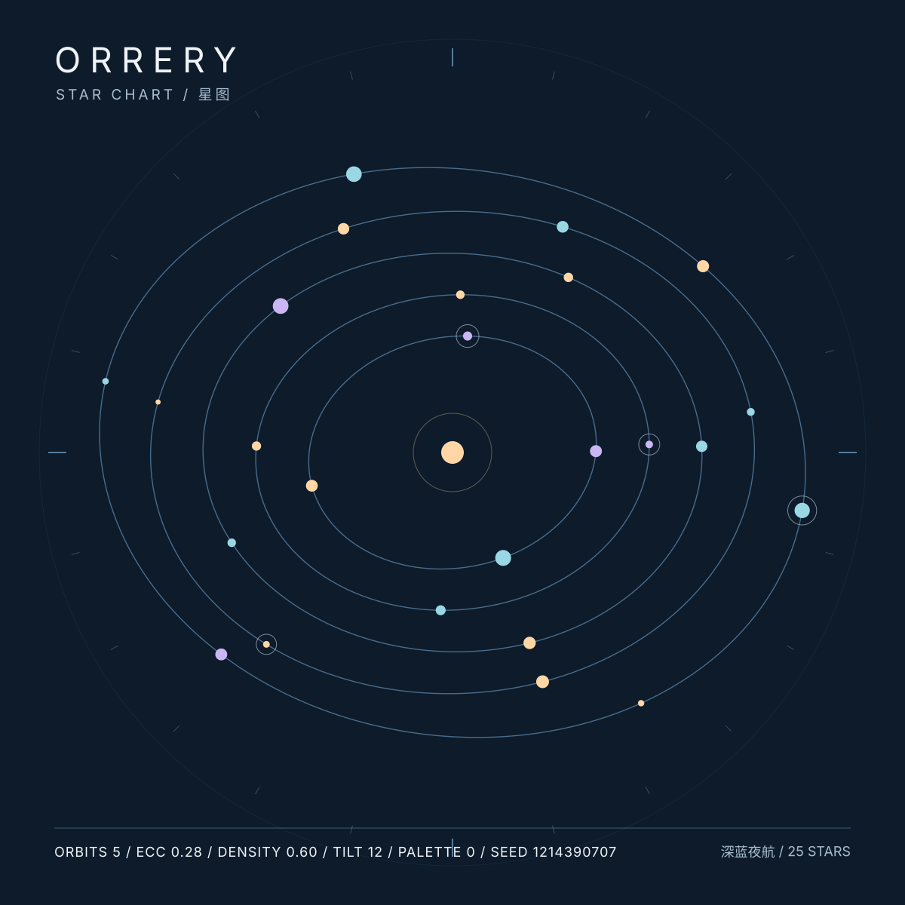
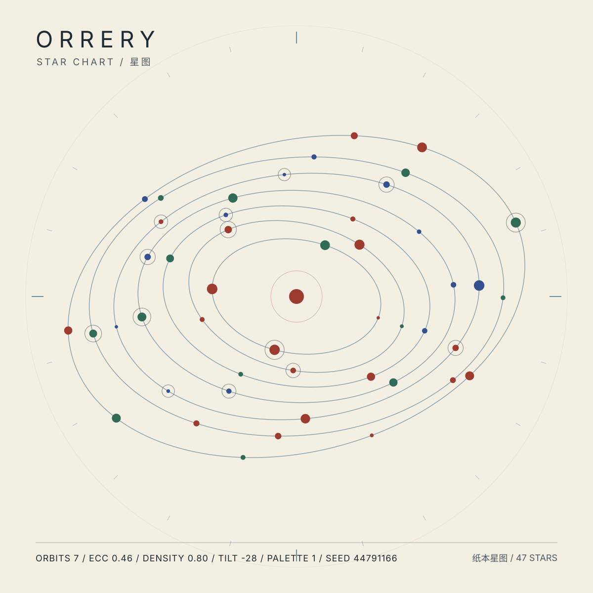
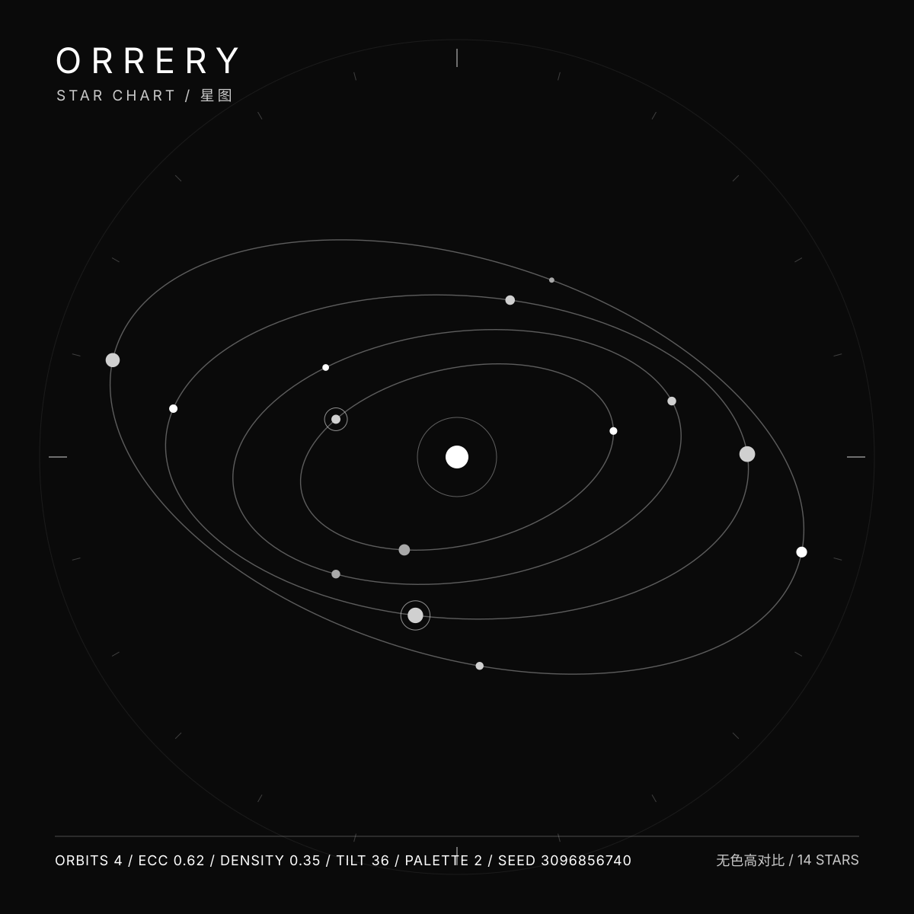

# ORRERY / 星图

**一款无胜负的星系编排玩具：调参、观察、定格，把成果导出成一张矢量海报。**



<p align="center">
  
  
</p>

## 为什么是它

参数少、结果多：只有 5 个控件，没有关卡、没有分数、没有账号。每次游玩都会留下一张可以带走、可以直接提交进仓库的 SVG 海报——**产物即作品**。同一组参数永远生成同一张海报，可复现、可分享、可写进 README 首屏。

## 立即试玩

**在线**：本仓库开启 GitHub Pages 后，README 首屏上方即是成品，`index.html` 点开即玩，无需安装。

**本地**：直接双击 `index.html`（零构建、零依赖、离线可用）。若需要 `http://` 环境（例如剪贴板权限），运行：

```bash
npm run serve
# 打开 http://127.0.0.1:8080/
```

> `npm run serve` 只用于本地预览，不是运行前置条件。Node 仅用于测试与海报生成脚本。

## 玩法与规则

| 项 | 说明 |
|---|---|
| 核心动词 | 调参（tune）→ 观察（observe）→ 定格（freeze）→ 导出（export） |
| 胜负 | **无**。不设通关、评分、失败、进度，由玩家自设目标（如「三星共线」「只用两色」） |
| 单局 | 无单局概念，单次会话 2–10 分钟，可随时离开 |
| 装饰性动效 | 缓慢公转，可一键关闭；系统开启「减少动效」时自动关闭 |
| 跨会话保留 | 本地参数预设（JSON 文件）与导出的海报文件；不写云端 |

### 五个参数

| 控件 | 范围 | 作用 |
|---|---|---|
| 轨道数 | 3–9 条 | 决定轨道层数与半径分布 |
| 离心率 | 0–0.65 | 0 为正圆，越大椭圆越扁 |
| 密度 | 0.2–1.0 | 控制每条轨道上的星体数量 |
| 倾角 | −45° – 45° | 让各层轨道逐层偏转 |
| 配色 | 3 套 | 深蓝夜航 / 纸本星图 / 无色高对比 |

控件数量是硬红线：**可见参数控件不超过 5 个**，避免认知过载（cognitive overload）。按钮（定格、导出、分享等）属于动作，不计入参数控件。

### 操作

| 按钮 | 行为 |
|---|---|
| 定格 | 停止装饰性公转，锁定当前构图供导出 |
| 换一组参数 | 随机生成一组新参数（仍走同一套夹取规则） |
| 关闭/开启公转 | 切换装饰性动画 |
| 导出 SVG 海报 | 下载自足的静态矢量文件，离线可开 |
| 导出 PNG 海报 | 同一份 SVG 经 Canvas 栅格化为 2400 × 2400 PNG |
| 复制分享链接 | 把参数编码进 URL，别人打开即见同一张星图 |
| 保存/载入参数预设 | JSON 文件，便于复现某张海报 |

**键盘**：全部控件与按钮原生可聚焦、可键盘操作，有可见焦点指示；`Tab` 顺序与视觉顺序一致。屏幕阅读器可读取 SVG 内的 `<title>` 与 `<desc>`。

## 目录

```
orrery/
├── index.html                 页面骨架（零构建，双击即开）
├── style.css                  样式与可访问性基线
├── src/
│   ├── prng.js                确定性伪随机数发生器
│   ├── params.js              参数规格、夹取规则、URL 编解码
│   ├── palette.js             三套自产配色
│   ├── geometry.js            参数 → 轨道几何（纯函数）
│   ├── render.js              system → SVG 字符串 + 输出安全自检
│   ├── export.js              SVG / PNG 导出、分享、预设
│   └── main.js                唯一接触 DOM 的装配层
├── assets/posters/            三张内置示例海报（由源码生成，可复现）
├── docs/                      设计说明、架构说明、素材管线
├── tests/                     Node 内置 test runner 单元测试
├── scripts/                   海报生成、素材校验、烟雾测试、可选本地服务器
├── .github/                   CI 与 Issue / PR 模板
├── package.json  package-lock.json  零第三方依赖，仍锁住 lockfileVersion 供 CI 缓存
├── ASSETS.md  CREDITS.md      素材来源与许可标注
└── README.md  LICENSE  CONTRIBUTING.md  CHANGELOG.md
```

## 开发与验证

```bash
npm test              # 29 条单测：确定性、夹取规则、对比度、SVG 安全自检、导出层
npm run smoke         # 页面装配烟雾测试：用最小 DOM 桩真实执行页面脚本
npm run posters       # 用同一套纯函数重新生成 assets/posters/ 三张海报
npm run check-assets  # 校验海报自足无外部引用、文档齐备
npm run check         # 以上全部
```

CI（`.github/workflows/ci.yml`）跑单测、烟雾测试、重生成海报并 `git diff --exit-code`——**同参数不同产物会直接让构建失败**。这是「确定性」的持续保证，不是一次性断言。

## 设计要点

- **没有游戏状态机**：只有参数到几何的一次性映射。这也意味着不用担心存档迁移、状态机边界与平衡性。
- **纯函数核心 + 单一 DOM 层**：`prng / params / palette / geometry / render` 完全无 DOM 依赖，因此能在 Node 里直接被单测覆盖；`main.js` 只做装配。
- **输出安全自检**：生成侧用白名单（文本转义、颜色格式校验、画布尺寸强制数值），导出侧再以 `inspectSvg()` 兜底，拦截外部 URL、脚本、`foreignObject`、内嵌字体、内联事件、DOCTYPE/实体声明与内联样式表；拦截规则自身有正反向单测（既防漏报也防误报）。
- **分层授权**：`LICENSE` 管代码，`ASSETS.md` 管素材。所有素材为项目自产或系统字体回退，**零外部素材**。
- **可访问性目标 Standard**：对比度经逐色断言校验、不把颜色当唯一编码（另有无色高对比配色 + 文字信息）、200% 缩放、键盘与触屏、`prefers-reduced-motion`、SVG 内 `<title>`/`<desc>` 文本替代。详见 `docs/design.md`。

## 已知限制

- 导出 PNG 依赖浏览器 Canvas；SVG 导出不依赖任何浏览器特性之外的能力。
- 海报文字只使用通用系统字体族名称，不嵌入字体文件；不同机器上字形会有差异，几何完全一致。
- 无胜负、无进度，深度有限：这是明确的取舍，不是缺口。自设目标与「产物即作品」构成本作的玩法边界。
- GitHub Pages 需由仓库维护者在 Settings 中开启（本仓库不自动部署）。

## 许可与致谢

- 代码：MIT，见 [LICENSE](LICENSE)。
- 素材：全部为项目自产或系统字体回退，**零外部素材**，逐项登记见 [ASSETS.md](ASSETS.md)；致谢见 [CREDITS.md](CREDITS.md)。
- 项目名、Logo 与第三方名称不因代码许可而获得商标授权。

---

作者：廖康庄
